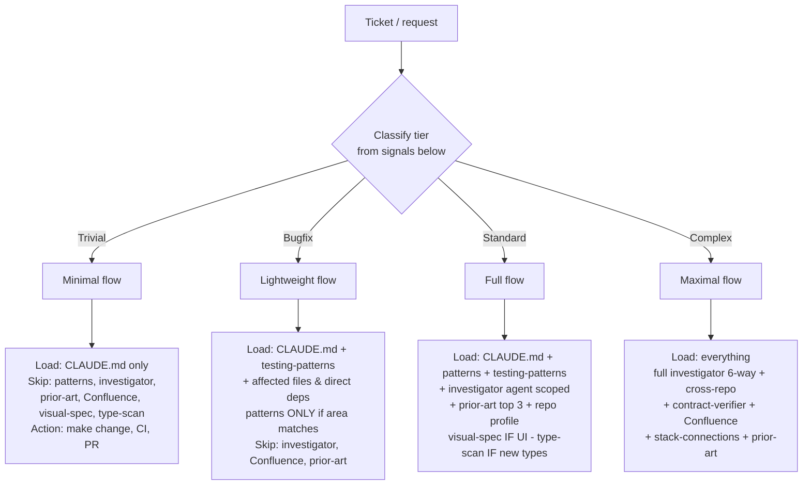

# Routing & Context-Loading Flowchart

**Single source of truth** for how much context a command loads. Classify the ticket ONCE, early, then load only what the tier needs.

**Why this exists:** loading irrelevant context (e.g. the full `codebase-patterns.md` for a Dependabot bump) doesn't just cost tokens — it *degrades a capable model's focus*, burns wall-clock, and pollutes the chat with noise the task never uses. Right-size the load to the work. This is the ONE place where "load less" is a quality win, not a token optimization.

Obeyed by: `/clarify` (Step 1.0) and `/ticket` (Step 1.1). Both resolve the SAME tier from the SAME signals below — they must not drift. (`/do` archived 2026-07-02 — see `capability-manifest.md`.) If you change a load profile, change it here, then the commands inherit it.

---

## The flow

## How to classify (first matching row wins, top-down)

| Signal in the ticket / diff | Tier |
|---|---|
| Dependabot / dependency or lockfile bump, version pin, config-only, single copy/text string, env var | **Trivial** |
| Localized bug, clear repro, ~1–3 files, no new API surface | **Bugfix** |
| New component / endpoint / feature in one repo; ≤ ~1 layer | **Standard** |
| Cross-repo or fullstack (FE+BFF+Go), new subsystem, contract change, security, data migration | **Complex** |

When ambiguous, pick the **lower** tier and let investigation escalate it — a Bugfix that turns out cross-repo gets re-tiered to Complex mid-flow (log the escalation). Never start Complex "to be safe."

## Load profile by tier

| Dimension | Trivial | Bugfix | Standard | Complex |
|---|:--:|:--:|:--:|:--:|
| `CLAUDE.md` | yes | yes | yes | yes |
| `testing-patterns.md` | yes | yes | yes | yes |
| `codebase-patterns.md` | **no** | only if area matches (index) | yes | yes (full) |
| codebase-investigator agent | **no** | no (or scoped) | scoped | full 6-way |
| Prior-art lookup (Step 1.5b) | **no** | only if similar prior bug | top 3 | yes |
| Confluence business context | **no** | **no** | if business logic | yes |
| `stack-connections.md` | **no** | only if API bug | if API change | yes |
| Visual-spec extraction (Step 2.5b) | **no** | if UI | if UI | if UI |
| Type-duplication scan (Step 4e) | **no** | **no** | if new types | yes |
| contract-verifier agent | **no** | **no** | if contract touched | yes |
| `command-proposals.md` grep | **no** | **no** | yes | yes |
| Phase plan | skipped | skipped | if multi-layer | yes |

"only if …" = load lazily, when that specific trigger fires — not by default.

## Command-specific behavior

- **`/clarify`** — classify at Step 1.0 (right after fetching the ticket, before loading any pattern/stack files). If **Trivial**, skip Steps 1.5/1.5b/1.8/2.5/2.5b/3/4e and emit a one-paragraph blueprint (`tier: Trivial`, the file(s) to touch, the check to run). Otherwise load per the table and run the gated steps.
- **`/ticket`** — classify at Step 1.1. Use the matrix above as the canonical Context-Loading-per-Tier source.
- **`/project-debug`** — the destination of the cause-known gate (below). A root-cause-unknown bug starts HERE, not at `/ticket`: it produces `{REPO_ROOT}/.claude/debug/{slug}.md` with the symptom, hypotheses, and evidence, then hands a known root cause to `/ticket` for the fix.
- **`/qa`** — a failed QA step is a cause-unknown bug; §8d applies the gate and offers a `/project-debug` session rather than leaving a red row in the report.

## Escalation rule

Tier is a starting estimate, not a cage. If investigation reveals the work is bigger than the tier (a "bugfix" spans FE+BFF), re-tier upward, log `- [HH:MM] Re-tiered Bugfix → Complex: {reason}` in the state file, and load the additional context the new tier requires. Downward re-tiering is also fine if a "feature" turns out to be a one-line copy change.

## Bug intake: the cause-known gate

Tier classification answers "how much context." For bugs there's a prior question it doesn't ask: **do I already know the cause, or am I about to investigate?** A localized bug with a clear repro and a known file is a Bugfix-tier `/ticket`. A bug where you'd be *guessing* — intermittent, "why is this happening", can't reproduce yet, started failing for no obvious reason — is a **debug session first**, then a fix.

The gate is one question, asked at intake AND any time something fails mid-flow:

> **Can I name the cause in one sentence?**
> - **Yes** — typo, wrong import, off-by-one, a prop you can see is missing. Just fix it.
> - **No** — you're about to *try something to see if it helps*. That's the tell. Open a `/project-debug` session: it captures the symptom, your hypotheses, and what you ruled out in `{REPO_ROOT}/.claude/debug/{slug}.md`. The root cause + eliminated hypotheses then become `/learn` fuel and a regression test — knowledge that otherwise evaporates when you fix ad-hoc in chat.

Where the gate fires:
- **At intake** — a bug ticket whose cause is unknown routes through `/project-debug` to find the root cause, *then* `/ticket` to implement the fix. (The Bugfix row above assumes "clear repro"; when that's false, this gate diverts first.)
- **Mid-`/ticket`** — an unexplained failure during implementation auto-spins a linked debug session instead of a silent fix (see `/ticket` §5.1b).
- **Mid-`/qa`** — a failed QA step is a bug with unknown cause by definition; `/qa` offers to spin the session (see `/qa` §8d).

`/project-debug` is not an island reached only by deliberately typing it — these three seams pull it into the normal `/clarify → /ticket → /qa → /pr-creation` loop, so debugging gets captured whenever it's actually hard and stays out of the way when it isn't.
